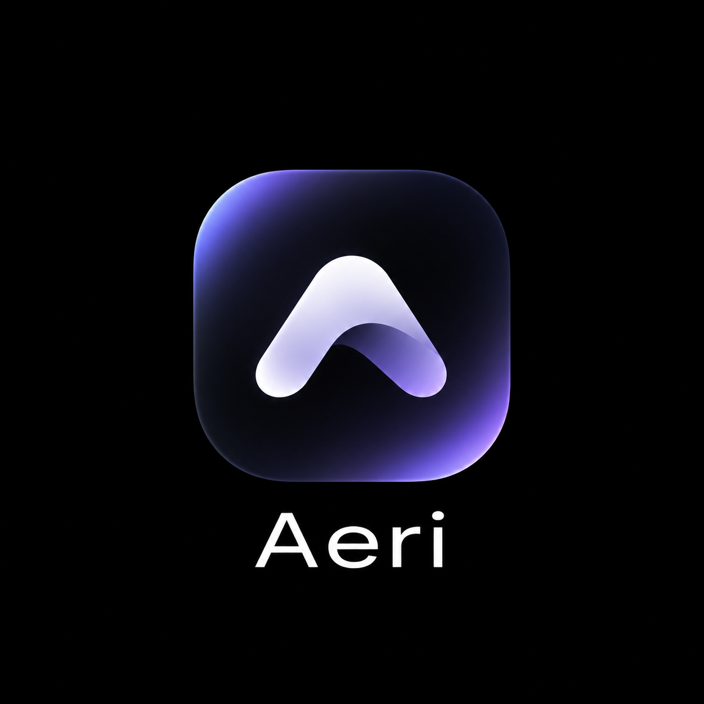

<p align="center"></p>

# Aeri

A lightweight macOS app that turns the MacBook notch into a small, useful space. Hover over the notch to expand it.

- **Now Playing**: track, artwork, controls and a draggable seek bar for Music, Spotify and browser media, with a glow in the artwork's color
- **Shelf**: drop files on the notch to hold them, then drag them out where you need them
- **Clipboard**: recent copies, with color swatches for hex codes, thumbnails for images and the host for links
- **Weather**: current conditions from [Open-Meteo](https://open-meteo.com), with no API key or account
- **Live Activities**: while the notch is closed, a tiny cover and moving bars beside it when music plays, plus brief alerts for charging, low battery, volume and brightness
- **Settings**: choose which tabs appear, set the weather city and units, and turn on Launch at Login

Requires macOS 14 or later on Apple Silicon. Uses about 30 MB of memory and close to 0% CPU when idle.

## Install

1. Download `Aeri-<version>.zip` from [Releases](https://github.com/fayezmuhammed/Aeri/releases) and unzip it.
2. Move `Aeri.app` to your Applications folder and open it.
3. Aeri isn't notarized by Apple, so macOS blocks the first launch. Open **System Settings › Privacy & Security**, scroll down, click **Open Anyway** and confirm. You only need to do this once.

   Alternatively, in Terminal: `xattr -dr com.apple.quarantine /Applications/Aeri.app`

Hover over the notch to open Aeri. Click the gear for **Settings…** or to quit.

## Permissions

Aeri works without any special permissions. macOS asks for these only when a feature needs them:

| Permission | Asked when | Used for |
| --- | --- | --- |
| **Automation** | Aeri first shows what's playing | Reading and controlling Music, Spotify and browser media |
| **Accessibility** (optional) | You turn it on in Settings › Live Activities | Hiding the system volume and brightness box, and moving live activities aside so they don't cover menu bar items |

Browser media also needs **Allow JavaScript from Apple Events** turned on in each browser (Safari: Develop menu; Chrome-based browsers: View › Developer).

Aeri isn't signed with an Apple Developer certificate, so macOS may ask for these permissions again after you update Aeri.

## Privacy

No accounts, analytics or tracking. Clipboard history and shelf items stay in memory on your Mac, and copies marked as secret by password managers are skipped. Weather requests go to Open-Meteo with only your chosen city's coordinates.

## Build from source

```bash
swift build --build-system native
swift run --build-system native
```

To package `dist/Aeri.app` and a release zip: `scripts/package.sh 0.2.0`

## License

[MIT](LICENSE)
